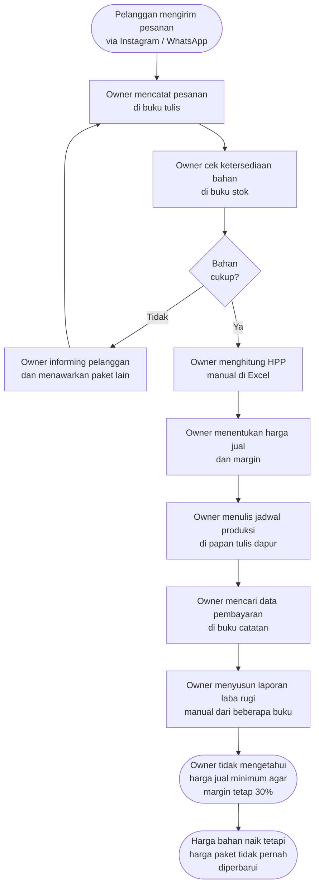
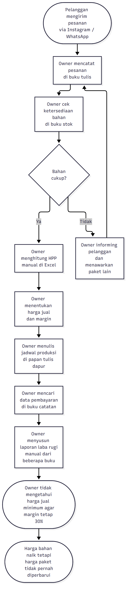
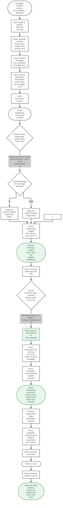
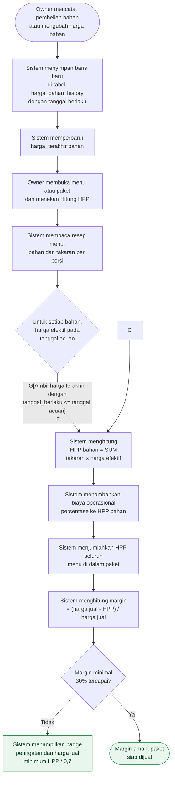
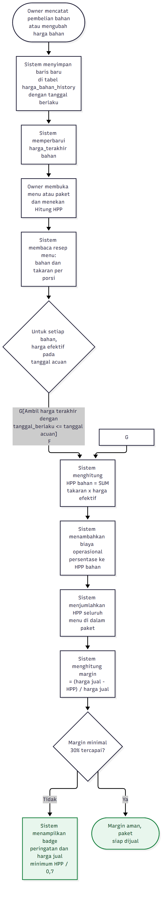
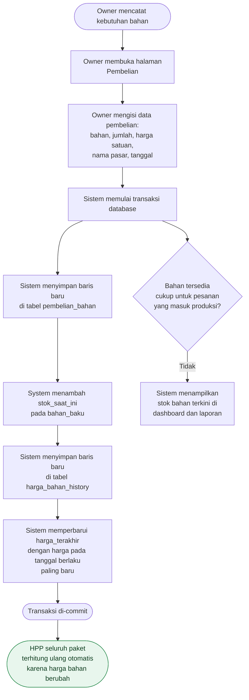
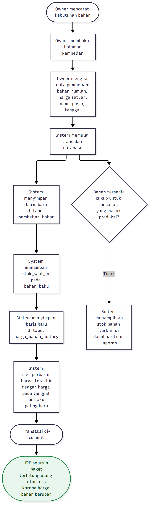
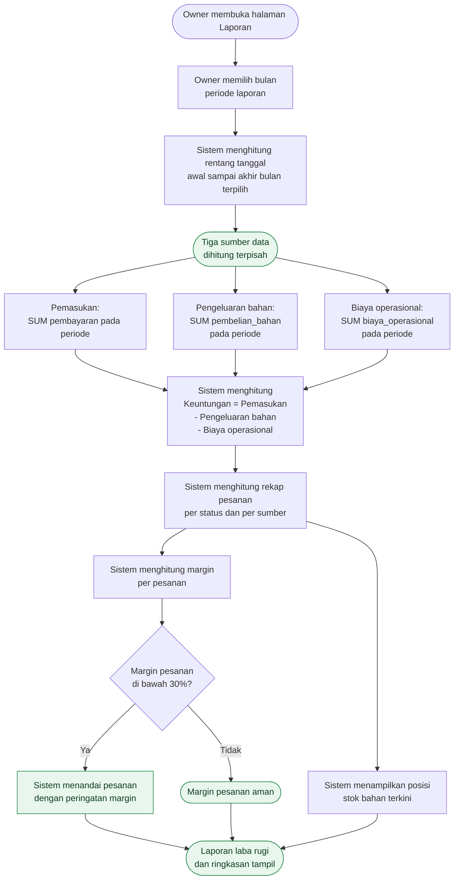
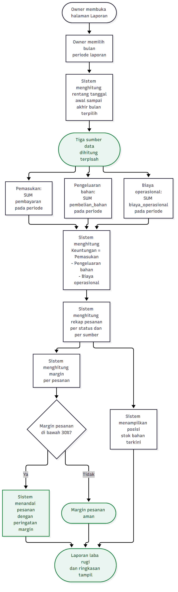

# Diagram Proses Usulan

Dokumen ini memuat diagram alur proses (flowchart) untuk Sistem Informasi Manajemen (SIM)
Dina Catering. Isinya:

1. **Diagram Alur Proses Manual (Situasi Saat Ini)** — proses yang berjalan sebelum ada sistem.
2. **Diagram Alur Proses Usulan (Sistem Baru)** — proses yang digantikan oleh aplikasi web.
3. **Diagram Proses Pengadaan Bahan dan Stok**.
4. **Diagram Proses Pelaporan Keuangan**.

Semua diagram mengikuti simbol flowchart standar:

| Simbol | Arti | Contoh dalam sistem ini |
|---|---|---|
| Terminal (oval) | Awal / akhir proses | "Owner menerima pesanan" |
| Proses (persegi panjang) | Aktivitas yang dilakukan | "Hitung HPP per porsi" |
| Keputusan (belah ketupat) | Percabangan ya/tidak | "Margin < 30%?" |
| Input/Output (paralelogram) | Masukan atau keluaran data | "Data pesanan" |
| Penyimpanan data (persegi terbuka) | Basis data / berkas | "Tabel pesanan" |

---

## 1. Diagram Alur Proses Manual (Situasi Saat Ini)

Sebelum aplikasi ini dibuat, owner usaha katering mencatat seluruh data secara manual.
Diagram berikut menunjukkan alur yang biasa dijalankan.

**Catatan masalah yang teridentifikasi:**

| No | Masalah | Dampak |
|---|---|---|
| 1 | Stok dicatat manual di buku | Sulit mengetahui sisa bahan tanpa membuka buku |
| 2 | HPP dihitung manual di Excel | Terlambat, tidak otomatis berubah saat harga bahan naik |
| 3 | Harga paket tidak pernah ditinjau ulang | Margin menyusut tanpa disadari |
| 4 | Jadwal produksi hanya di papan tulis | Sulit melacak PIC dan status pengerjaan tugas |
| 5 | Pembayaran tercatatmanual di buku | Tidak ada pengingat jatuh tempo DP maupun pelunasan |
| 6 | Laporan laba rugi disusun manual | Sulit dan sering tidak akurat |

---

## 2. Diagram Alur Proses Usulan (Sistem Baru)

Diagram ini adalah alur utama pada aplikasi web. Setiap kotak memetakan ke halaman dan
service nyata pada kode aplikasi.

```mermaid
flowchart TD
 A([Pelanggan mengirim pesanan<br/>via Instagram / WhatsApp]) --> B[Owner login ke aplikasi<br/>SIM Dina Catering]
 B --> C[Owner membuka halaman<br/>Pesanan dan mengisi form<br/>pesanan baru]

 C --> D[Owner memilih Pelanggan<br/>atau menambah pelanggan baru]
 D --> E[Owner memilih Paket Menu<br/>dan mengisi jumlah tamu<br/>serta tanggal acara]

 E --> F[Owner menyimpan pesanan]
 F --> G([Sistem menghitung total harga<br/>otomatis])
 G --> H{Sistem mencari harga paket<br/>berlaku pada tahun acara}
 H -- I[Ambil baris paket dengan<br/>tahun_berlaku &lt;= tahun acara<br/>paling dekat]
 H --> J{Saturday/Minggu<br/>dan ada harga weekend?}
 J -- Ya --> K[Harga jual efektif memakai<br/>harga akhir pekan]
 J -- Tidak --> L[Harga jual efektif memakai<br/>harga biasa]
 I --> M[Sistem menghitung tenggat<br/>DP H-30 dan pelunasan H-7]
 K --> M
 L --> M

 M --> N([Pesanan tersimpan dengan<br/>status 'baru' dan<br/>tenggat pembayaran]):::output

 N --> O[Owner mencatat pembayaran DP 50%]
 O --> P{Sistem membuat tugas produksi<br/>default untuk hari acara}
 P -- Q[Persiapan bahan H-1, Masak H,<br/>Plating H, Pengiriman H]
 Q --> R[Status pesanan naik otomatis<br/>ke 'final_meeting']:::output
 R --> S[Owner melakukan final meeting<br/>dan survei lokasi bersama pelanggan]

 S --> T[Owner mengubah status pesanan<br/>menjadi 'produksi']
 T --> U([Sistem mengurangi stok bahan<br/>sesuai resep x jumlah tamu<br/>dalam satu transaksi]):::output
 U --> V[Tim dapur mengerjakan tugas<br/>pada papan produksi]
 V --> W[Owner mengubah status pesanan<br/>menjadi 'pengiriman' lalu 'selesai']
 W --> X[Owner mencatat pelunasan]
 X --> Y([Pesanan lunas])

 Y --> Z[Owner membuka halaman Laporan]
 Z --> AA([Laba rugi, rekap pesanan,<br/>margin per pesanan, dan<br/>posisi stok bahan]):::output

 classDef output fill:#e8f6ed, stroke:#15803d, color:#0b3d1e
```

### 2.1 Percabangan dan aturan yang dijalankan sistem

| Percabangan | Aturan yang dipakai | Sumber kode |
|---|---|---|
| Harga paket yang berlaku | Cari baris `paket_menu` dengan `tahun_berlaku <= tahun(tanggal_acara)`, ambil yang terdekat | `internal/service/harga.go` |
| Harga akhir pekan | Bila tanggal acara Sabtu/Minggu **dan** `harga_per_porsi_weekend` tidak NULL, pakai harga weekend | `internal/service/harga.go` |
| Total harga pesanan | `jumlah_tamu x harga_jual_efektif` | `internal/service/pesanan.go` |
| Tenggat pembayaran | DP = tanggal acara − 30 hari; pelunasan = tanggal acara − 7 hari | `internal/service/pembayaran.go` |
| Status naik saat DP masuk | Bila status masih `baru` dan tipe pembayaran `dp`, status otomatis menjadi `final_meeting` | `internal/service/pembayaran.go` |
| Tugas produksi default | Dibuat saat DP dicatat, bersifat idempoten (tidak pernah digandakan) | `internal/service/pesanan.go` |
| Pengurangan stok | Terjadi saat status pesanan diubah menjadi `produksi`, sekali jalan dalam satu transaksi | `internal/service/stok.go` |
| Deteksi margin rendah | Bila margin paket < 30%, tampil badge peringatan dan harga jual minimum `HPP / 0,7` | `internal/service/hpp.go` |

### 2.2 Diagram alur perhitungan HPP (inti sistem)

Alur di atas bergantung pada satu perhitungan yang dilakukan sistem secara otomatis setiap kali
harga bahan berubah. Alur perhitungan tersebut:

---

## 3. Diagram Proses Pengadaan Bahan dan Stok

Pencatatan pembelian di pasar diperlakukan sebagai satu transaksi tunggal agar stok, harga
terakhir, dan riwayat harga selalu konsisten.

**Catatan aturan:**

| Aturan | Penjelasan |
|---|---|
| Satu transaksi | Penambahan stok, penambahan riwayat harga, dan pembaruan harga terakhir di-commit bersama. Bila satu gagal, semuanya batal. |
| Harga berlaku sejak tanggal | Baris riwayat harga memiliki `tanggal_berlaku`, sehingga HPP historis dapat dihitung ulang untuk tanggal tertentu. |
| Harga terakhir tidak turun | Bila ada entri harga yang tanggalnya lebih lama, `harga_terakhir` tetap mengikuti baris terbaru — harga lama tidak menimpa harga baru. |

---

## 4. Diagram Proses Pelaporan Keuangan

Laporan laba rugi memakai angka yang benar-benar tercatat, bukan estimasi.

**Catatan:** persentase biaya operasional (default 10%) yang dipakai pada perhitungan HPP
**tidak** ditambahkan ke laba rugi. Laba rugi memakai biaya operasional aktual yang dicatat
pada tabel `biaya_operasional`, sehingga kedua perhitungan tidak tumpang tindih.

---

## 5. Keterkaitan diagram dengan modul aplikasi

| Diagram | Modul aplikasi | Rute |
|---|---|---|
| Proses manual (Bagian 1) | — | Alur lama, tidak ada dalam kode |
| Proses usulan (Bagian 2) | Pesanan, Pembayaran, Produksi, Pelanggan | `/pesanan`, `/pesanan/{id}/pembayaran`, `/produksi` |
| Perhitungan HPP (Bagian 2.2) | Paket & Margin, Kalkulator HPP | `/paket`, `/hpp/hasil` |
| Pengadaan bahan (Bagian 3) | Bahan Baku, Pembelian | `/bahan`, `/bahan/{id}/harga`, `/pembelian` |
| Pelaporan keuangan (Bagian 4) | Laporan, Biaya | `/laporan`, `/biaya` |
