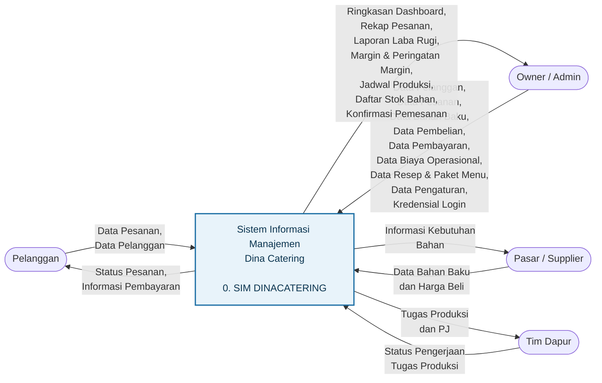
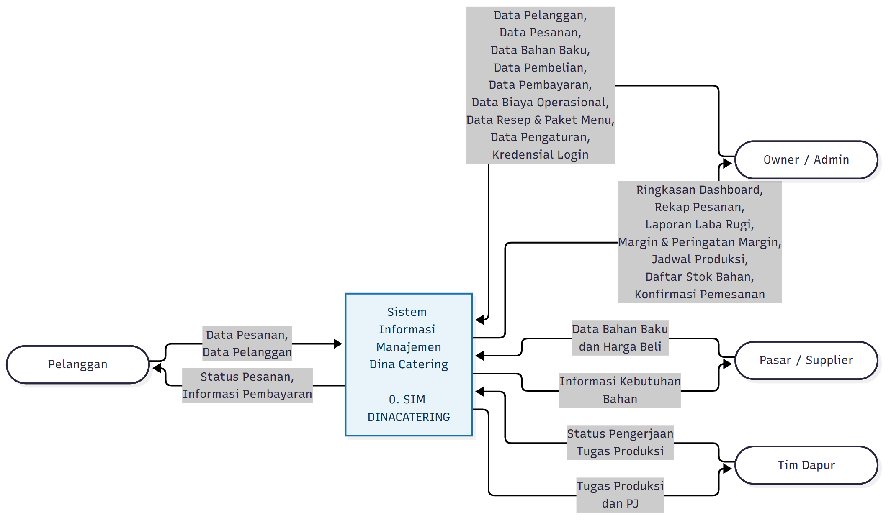
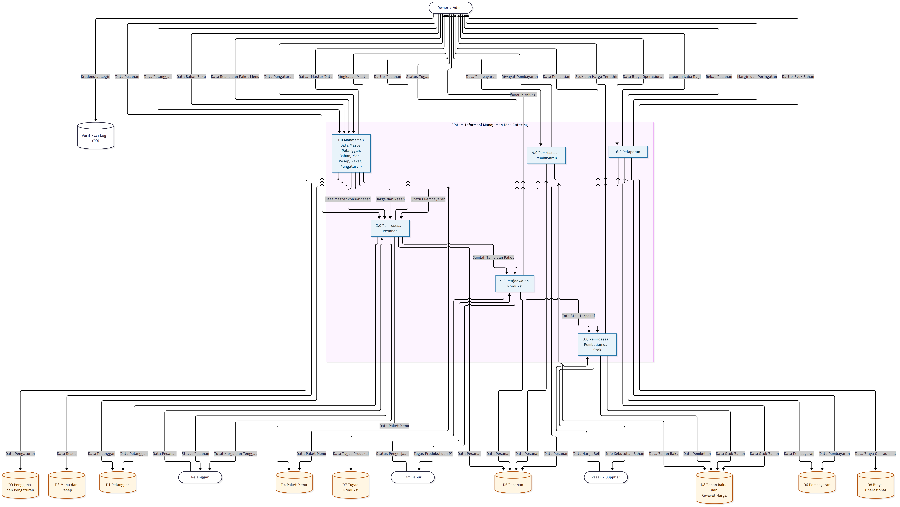

# Data Flow Diagram (DFD)

Dokumen ini memuat DFD Level 0 (Context Diagram) dan Level 1 untuk Sistem Informasi
Manajemen (SIM) Dina Catering.

**Notasi yang dipakai** (mengikuti notasi DFD Yourdon-DeMarco):

| Simbol | Arti |
|---|---|
| Persegi panjang dengan nomor | Proses |
| Oval / lingkaran | Entitas luar |
| Persegi terbuka (dua garis paralel) | Penyimpanan data (data store) |
| Panah | Aliran data |

---

## 1. DFD Level 0 — Context Diagram

Level 0 menggambarkan sistem sebagai satu proses tunggal, sehingga terlihat aliran data
masuk dan keluar dari batas sistem.

### 1.1 Daftar aliran data pada Level 0

| No | Asal | Tujuan | Nama Aliran Data | Keterangan |
|---|---|---|---|---|
| 1 | Pelanggan | SIM | Data Pesanan | Pesanan yang masuk lewat Instagram, WhatsApp,-mouth to mouth, atau hotel |
| 2 | Pelanggan | SIM | Data Pelanggan | Nama, kontak, alamat, dan catatan pelanggan |
| 3 | Owner | SIM | Data Pelanggan | Data pelanggan baru atau perubahan |
| 4 | Owner | SIM | Data Pesanan | Form pesanan baru dan perubahan status pesanan |
| 5 | Owner | SIM | Data Bahan Baku | Master bahan baku, satuan, stok, dan harga terakhir |
| 6 | Owner | SIM | Data Pembelian | Pembelian bahan di pasar: jumlah, harga satuan, nama pasar |
| 7 | Owner | SIM | Data Pembayaran | Pencatatan DP dan pelunasan |
| 8 | Owner | SIM | Data Biaya Operasional | Catatan biaya gas, listrik, mobilitas, perlengkapan |
| 9 | Owner | SIM | Data Resep & Paket Menu | Menu, bahan per porsi, paket dan harga jualnya |
| 10 | Owner | SIM | Data Pengaturan | Persentase biaya operasional yang dipakai menghitung HPP |
| 11 | Owner | SIM | Kredensial Login | Username dan password untuk masuk ke aplikasi |
| 12 | Pasar | SIM | Data Bahan Baku dan Harga Beli | Informasi bahan yang dibeli beserta harga di pasar |
| 13 | Tim Dapur | SIM | Status Pengerjaan Tugas Produksi | Status tugas dan penanggung jawab |
| 14 | SIM | Owner | Ringkasan Dashboard | Jumlah pelanggan, menunggu bayar, pemasukan, keuntungan |
| 15 | SIM | Owner | Rekap Pesanan | Rekap pesanan per status dan per sumber |
| 16 | SIM | Owner | Laporan Laba Rugi | Pemasukan, pengeluaran bahan, biaya operasional, keuntungan |
| 17 | SIM | Owner | Margin dan Peringatan Margin | Margin paket dan pesanan, termasuk paket di bawah 30% |
| 18 | SIM | Owner | Jadwal Produksi | Papan tugas produksi beserta PJ dan deadline |
| 19 | SIM | Owner | Daftar Stok Bahan | Stok bahan terkini |
| 20 | SIM | Pelanggan | Status Pesanan dan Pembayaran | Konfirmasi pesanan diterima, jadwal pembayaran, dan pelunasan |
| 21 | SIM | Pasar | Informasi Kebutuhan Bahan | Permintaan pembelian bahan ke pasar |
| 22 | SIM | Tim Dapur | Tugas Produksi dan PJ | Daftar tugas masak, plating, dan pengiriman beserta penanggung jawab |

---

## 2. DFD Level 1

Level 1 menguraikan proses tunggal pada Level 0 menjadi enam proses yang saling terhubung,
serta penyimpanan data yang dipakai bersama.

```mermaid
flowchart TB
 Owner([Owner / Admin])
 Pelanggan([Pelanggan])
 Pasar([Pasar / Supplier])
 Dapur([Tim Dapur])

 subgraph SIMD["Sistem Informasi Manajemen Dina Catering"]
 P1["1.0 Manajemen Data Master<br/>(Pelanggan, Bahan, Menu,<br/>Resep, Paket, Pengaturan)"]
 P2["2.0 Pemrosesan Pesanan"]
 P3["3.0 Pemrosesan Pembelian dan Stok"]
 P4["4.0 Pemrosesan Pembayaran"]
 P5["5.0 Penjadwalan Produksi"]
 P6["6.0 Pelaporan"]
 end

 D1[("D1 Pelanggan")]
 D2[("D2 Bahan Baku dan<br/>Riwayat Harga")]
 D3[("D3 Menu dan Resep")]
 D4[("D4 Paket Menu")]
 D5[("D5 Pesanan")]
 D6[("D6 Pembayaran")]
 D7[("D7 Tugas Produksi")]
 D8[("D8 Biaya Operasional")]
 D9[("D9 Pengguna dan Pengaturan")]

 Owner -->|Data Pelanggan| P1
 Owner -->|Data Bahan Baku| P1
 Owner -->|Data Resep dan Paket Menu| P1
 Owner -->|Data Pengaturan| P1
 Owner -->|Data Pesanan| P2
 Owner -->|Data Pembelian| P3
 Owner -->|Data Pembayaran| P4
 Owner -->|Status Tugas| P5
 Owner -->|Data Biaya Operasional| P6
 Owner -->|Kredensial Login| P9[("Verifikasi Login<br/>(D9)")]

 Pelanggan -->|Data Pesanan| P2
 Pasar -->|Data Harga Beli| P3
 Dapur -->|Status Pengerjaan| P5

 P1 -->|Data Pelanggan| D1
 P1 -->|Data Bahan Baku| D2
 P1 -->|Data Resep| D3
 P1 -->|Data Paket Menu| D4
 P1 -->|Data Pengaturan| D9

 P2 -->|Data Pesanan| D5
 P3 -->|Data Pembelian| D2
 P4 -->|Data Pembayaran| D6
 P5 -->|Data Tugas Produksi| D7
 P6 -->|Data Biaya Operasional| D8

 P2 -->|Data Pelanggan| D1
 P2 -->|Data Paket Menu| D4
 P4 -->|Data Pesanan| D5
 P5 -->|Data Pesanan| D5
 P3 -->|Data Stok Bahan| D2
 P6 -->|Data Pesanan| D5
 P6 -->|Data Pembayaran| D6
 P6 -->|Data Stok Bahan| D2

 P1 -->|Data Master consolidated| P2
 P1 -->|Harga dan Resep| P2
 P5 -->|Info Stok terpakai| P3
 P2 -->|Jumlah Tamu dan Paket| P5
 P4 -->|Status Pembayaran| P2

 P2 -->|Status Pesanan| Pelanggan
 P2 -->|Total Harga dan Tenggat| Pelanggan
 P1 -->|Daftar Master Data| Owner
 P2 -->|Daftar Pesanan| Owner
 P3 -->|Info Kebutuhan Bahan| Pasar
 P3 -->|Stok dan Harga Terakhir| Owner
 P4 -->|Riwayat Pembayaran| Owner
 P5 -->|Tugas Produksi dan PJ| Dapur
 P5 -->|Papan Produksi| Owner
 P6 -->|Laporan Laba Rugi| Owner
 P6 -->|Rekap Pesanan| Owner
 P6 -->|Margin dan Peringatan| Owner
 P6 -->|Daftar Stok Bahan| Owner
 P1 -->|Ringkasan Master| Owner

 classDef proc fill:#e8f3fa, stroke:#1d6fa5, color:#0b3550, stroke-width:2px
 classDef store fill:#fff6e3, stroke:#b45309, color:#5a2b04
 class P1,P2,P3,P4,P5,P6 proc
 class D1,D2,D3,D4,D5,D6,D7,D8,D9 store
```

### 2.1 Deskripsi proses pada Level 1

| No | Nama Proses | Rincian Kegiatan |
|---|---|---|
| 1.0 | Manajemen Data Master | Mencatat pelanggan, bahan baku, menu dan resep, paket menu, serta pengaturan persentase biaya operasional. Memvalidasi nama bahan dan nama menu agar unik. |
| 2.0 | Pemrosesan Pesanan | Menerima pesanan baru, memilih pelanggan dan paket, menghitung total harga (harga akhir pekan bila perlu), menghitung tenggat DP H-30 dan pelunasan H-7, serta mengubah status pesanan sesuai alur kerja. |
| 3.0 | Pemrosesan Pembelian dan Stok | Mencatat pembelian bahan di pasar dalam satu transaksi: menambah stok, menambah riwayat harga, memperbarui harga terakhir. Mengurangi stok bahan saat pesanan masuk status produksi sesuai resep dikali jumlah tamu. |
| 4.0 | Pemrosesan Pembayaran | Mencatat DP dan pelunasan, menghitung sisa tagihan, menandai status pembayaran (belum DP, DP terbayar, lunas), dan memeriksa jatuh tempo. Status pesanan otomatis naik ke `final_meeting` saat DP dicatat. |
| 5.0 | Penjadwalan Produksi | Membuat tugas produksi default saat DP dicatat (idempoten), menampilkan papan produksi, menetapkan penanggung jawab, dan mengubah status pengerjaan tugas. |
| 6.0 | Pelaporan | Menyusun laba rugi periode (pemasukan, pembelian bahan, biaya operasional, keuntungan), rekap pesanan per status dan per sumber, margin per pesanan, peringatan margin di bawah 30%, dan posisi stok bahan. |

### 2.2 Daftar penyimpanan data (data store)

| Kode | Nama Penyimpanan | Isi | Ditulis oleh | Dibaca oleh |
|---|---|---|---|---|
| D1 | Pelanggan | Data pelanggan dan jumlah pesanan per pelanggan | 1.0, 2.0 | 1.0, 2.0, 6.0 |
| D2 | Bahan Baku dan Riwayat Harga | Master bahan, stok saat ini, harga terakhir, dan riwayat harga bertanggal berlaku | 1.0, 3.0 | 1.0, 3.0, 6.0 |
| D3 | Menu dan Resep | Menu yang tersedia beserta bahan dan takaran per porsi | 1.0 | 1.0, 2.0, 6.0 |
| D4 | Paket Menu | Paket, harga per porsi, harga akhir pekan, tahun berlaku, dan isi paket | 1.0 | 1.0, 2.0, 6.0 |
| D5 | Pesanan | Pesanan beserta pelanggan, paket, jumlah tamu, tanggal acara, total, dan status | 2.0 | 2.0, 4.0, 5.0, 6.0 |
| D6 | Pembayaran | Riwayat pembayaran DP dan pelunasan | 4.0 | 4.0, 6.0 |
| D7 | Tugas Produksi | Tugas masak, plating, dan pengiriman beserta PJ dan status | 5.0 | 5.0, 6.0 |
| D8 | Biaya Operasional | Catatan biaya gas, listrik, mobilitas, dan perlengkapan | 6.0 | 6.0 |
| D9 | Pengguna dan Pengaturan | Akun login dan pengaturan key-value (persentase biaya operasional) | 1.0 | 1.0, 2.0, 6.0 |

### 2.3 Neraca aliran data per data store

| Penyimpanan | Proses menulis | Proses membaca |
|---|---|---|
| D1 Pelanggan | 1.0, 2.0 | 1.0, 2.0, 6.0 |
| D2 Bahan Baku dan Riwayat Harga | 1.0, 3.0 | 1.0, 3.0, 6.0 |
| D3 Menu dan Resep | 1.0 | 1.0, 2.0, 6.0 |
| D4 Paket Menu | 1.0 | 1.0, 2.0, 6.0 |
| D5 Pesanan | 2.0 | 2.0, 4.0, 5.0, 6.0 |
| D6 Pembayaran | 4.0 | 4.0, 6.0 |
| D7 Tugas Produksi | 5.0 | 5.0, 6.0 |
| D8 Biaya Operasional | 6.0 | 6.0 |
| D9 Pengguna dan Pengaturan | 1.0 | 1.0, 2.0, 6.0 |

---

## 3. Kamus Data

Kamus data menjelaskan aliran data utama yang saling muncul pada Level 0 dan Level 1.

| Nama Aliran | Definisi | Struktur Data |
|---|---|---|
| Data Pelanggan | Identitas pelanggan yang melakukan pemesanan | `id`, `nama`, `kontak`, `alamat`, `catatan`, `created_at` |
| Data Pesanan | Pesanan katering beserta paket dan jumlah tamu | `id`, `pelanggan_id`, `paket_menu_id`, `jumlah_tamu`, `tanggal_acara`, `lokasi`, `sumber_pesanan`, `total_harga`, `status`, `catatan`, `masak_di_lokasi`, `tgl_jatuh_tempo_dp`, `tgl_jatuh_tempo_lunas` |
| Data Bahan Baku | Master bahan baku beserta stok dan harga terakhir | `id`, `nama`, `satuan`, `stok_saat_ini`, `harga_terakhir`, `created_at` |
| Data Pembelian | Transaksi pembelian bahan di pasar | `id`, `bahan_baku_id`, `jumlah`, `harga_satuan`, `total`, `pasar`, `tanggal` |
| Data Riwayat Harga | Harga satuan bahan pada tanggal tertentu | `id`, `bahan_baku_id`, `harga_satuan`, `tanggal_berlaku`, `created_at` |
| Data Resep | Bahan dan takaran per porsi untuk satu menu | `id`, `menu_id`, `bahan_baku_id`, `jumlah_per_porsi`, `satuan` |
| Data Paket Menu | Paket Menu beserta harga dan isi paket | `id`, `nama`, `harga_per_porsi`, `harga_per_porsi_weekend`, `tahun_berlaku`, `deskripsi` |
| Data Pembayaran | Catatan pembayaran DP atau pelunasan | `id`, `pesanan_id`, `jumlah`, `tipe`, `tanggal`, `metode` |
| Data Tugas Produksi | Tugas masak pada papan dapur beserta PJ | `id`, `pesanan_id`, `nama_tugas`, `pj`, `deadline`, `status` |
| Data Biaya Operasional | Catatan biaya operasional usaha | `id`, `kategori`, `deskripsi`, `jumlah`, `tanggal` |
| Data Pengaturan | Konfigurasi key-value runtime | `kunci`, `nilai`, `updated_at` |
| Kredensial Login | Username dan password terenkripsi | `username`, `password` (disimpan sebagai `password_hash` bcrypt) |
| Ringkasan Dashboard | Agregasi untuk halaman utama | jumlah pelanggan, jumlah menunggu bayar, pemasukan bulan ini, keuntungan bulan ini |
| Rekap Pesanan | Pengelompokan pesanan | `status` + jumlah, `sumber_pesanan` + jumlah |
| Laporan Laba Rugi | Rekap keuangan satu periode | `dari`, `sampai`, `pemasukan`, `pengeluaran_bahan`, `pengeluaran_operasional`, `keuntungan` |
| Margin dan Peringatan Margin | Margin paket dan pesanan beserta status peringatan | `nama`, `harga_jual_efektif`, `hpp_per_por`, `margin_persen`, `harga_jual_minimum`, `peringatan` |
| Jadwal Produksi | Agenda tugas produksi satu periode | `tanggal_acara`, `pelanggan_nama`, `paket_nama`, `jumlah_tamu`, `nama_tugas`, `pj`, `status` |
| Daftar Stok Bahan | Posisi stok bahan terkini | `nama`, `satuan`, `stok_saat_ini`, `harga_terakhir` |

---

## 4. Keterkaitan DFD dengan kode aplikasi

| Proses DFD | Rute pada aplikasi | Berkas utama |
|---|---|---|
| 1.0 Manajemen Data Master | `/pelanggan`, `/bahan`, `/menu`, `/paket`, `/pengaturan` | `internal/handler/pelanggan.go`, `bahan.go`, `menu.go`, `paket.go`, `pengaturan.go` |
| 2.0 Pemrosesan Pesanan | `/pesanan`, `/pesanan/{id}`, `/pesanan/{id}/status` | `internal/handler/pesanan.go`, `internal/service/pesanan.go` |
| 3.0 Pemrosesan Pembelian dan Stok | `/pembelian`, `/bahan/{id}/harga` | `internal/handler/pembelian.go`, `internal/service/bahan.go`, `internal/service/stok.go` |
| 4.0 Pemrosesan Pembayaran | `/pesanan/{id}/pembayaran` | `internal/service/pembayaran.go` |
| 5.0 Penjadwalan Produksi | `/produksi`, `/produksi/tugas/{id}/pj`, `/produksi/tugas/{id}/status` | `internal/handler/produksi.go` |
| 6.0 Pelaporan | `/laporan`, `/biaya` | `internal/handler/laporan.go`, `internal/service/laporan.go` |
| Verifikasi Login | `/login`, `/logout` | `internal/middleware/session.go`, `internal/handler/auth.go` |
