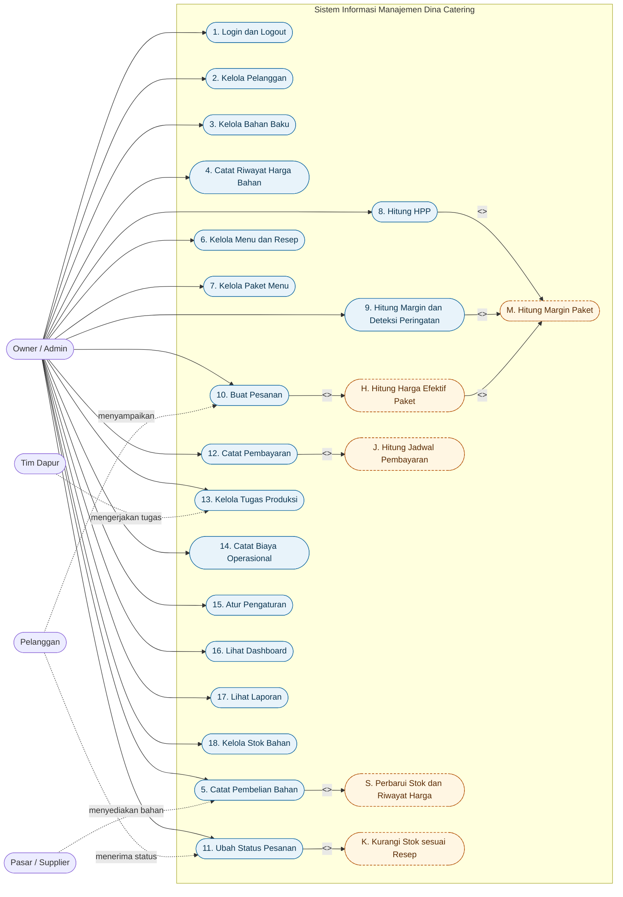
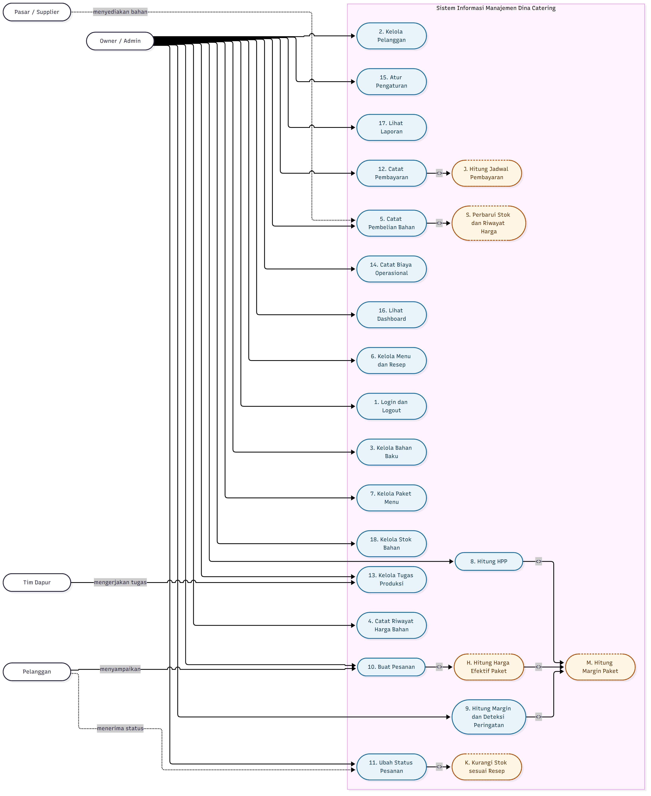

# Diagram Use Case

Dokumen ini memuat use case diagram dan deskripsi use case untuk Sistem Informasi Manajemen
(SIM) Dina Catering.

## 1. Aktor

| Aktor | Tipe | Keterangan |
|---|---|---|
| **Owner / Admin** | Aktor utama | Satu-satunya aktor yang masuk ke aplikasi. Pada implementasi sekarang seluruh akun ber-role `admin`; kolom `role` sudah tersedia tetapi belum dipakai untuk pembatasan hak akses. |
| **Pelanggan** | Aktor sekunder | Sumber pesanan. Tidak memiliki akun; berinteraksi lewat pesan Instagram, WhatsApp, atau saluran mulut ke mulut, dan hotel. |
| **Pasar / Supplier** | Aktor sekunder | Sumber pembelian bahan baku. Tidak memiliki akun; data nama pasar dicatat bebas pada saat pembelian. |
| **Tim Dapur** | Aktor sekunder | Pelaksana tugas produksi. Tidak memiliki akun; identitas direpresentasikan oleh kolom `pj` pada tugas produksi. |

---

## 2. Use Case Diagram

**Keterangan relasi:**

- `<<include>>` berarti use case tersebut **wajib** memanggil use case lain setiap kali dijalankan.
- Relasi bergaris putus-putus menandakan **interaksi tidak langsung** (aktor memang ada di domain
 bisnis, tetapi tidak masuk ke aplikasi).

---

## 3. Daftar use case

| No | Use Case | Aktor | Keterangan |
|---|---|---|---|
| 1 | Login dan Logout | Owner | Masuk dengan username dan password; sesi disimpan pada cookie bertanda tangan HMAC-SHA256 selama 12 jam. |
| 2 | Kelola Pelanggan | Owner | Tambah, cari, dan hapus data pelanggan beserta jumlah pesanannya. |
| 3 | Kelola Bahan Baku | Owner | Tambah dan hapus master bahan baku, satuan, stok awal, dan harga terakhir. |
| 4 | Catat Riwayat Harga Bahan | Owner | Menambah harga baru bertanggal berlaku; harga terakhir otomatis diperbarui. |
| 5 | Catat Pembelian Bahan | Owner | Mencatat pembelian di pasar: bahan, jumlah, harga satuan, nama pasar, tanggal. |
| 6 | Kelola Menu dan Resep | Owner | Menambah menu, menambah bahan per porsi, dan menghapus baris resep. |
| 7 | Kelola Paket Menu | Owner | Menambah paket beserta harga per porsi, harga akhir pekan, tahun berlaku, dan isi paket. |
| 8 | Hitung HPP | Owner | Menghitung HPP per porsi untuk satu menu atau satu paket pada tanggal acuan tertentu. |
| 9 | Hitung Margin dan Deteksi Peringatan | Owner | Menghitung margin dan menampilkan badge peringatan bila margin di bawah 30%. |
| 10 | Buat Pesanan | Owner | Membuat pesanan baru lengkap dengan total harga dan tenggat pembayaran. |
| 11 | Ubah Status Pesanan | Owner | Menggerakkan pesanan pada alur `baru`, `final_meeting`, `survei_lokasi`, `produksi`, `pengiriman`, `selesai`, atau `batal`. |
| 12 | Catat Pembayaran | Owner | Mencatat DP atau pelunasan; menghitung sisa tagihan dan menandai jatuh tempo. |
| 13 | Kelola Tugas Produksi | Owner | Menetapkan penanggung jawab dan mengubah status pengerjaan tugas di papan produksi. |
| 14 | Catat Biaya Operasional | Owner | Mencatat biaya gas, listrik, mobilitas, tenaga kerja, dan lain-lain. |
| 15 | Atur Pengaturan | Owner | Mengubah persentase biaya operasional yang ditambahkan ke HPP bahan. |
| 16 | Lihat Dashboard | Owner | Melihat ringkasan usaha, pesanan menunggu bayar, agenda 7 hari, dan peringatan margin. |
| 17 | Lihat Laporan | Owner | Melihat laba rugi, rekap pesanan, margin per pesanan, dan posisi stok bahan. |
| 18 | Kelola Stok Bahan | Owner | Melihat stok bahan terkini dan daftar pembelian bahan. |

---

## 4. Deskripsi use case

### UC-01 — Login dan Logout

| Aspek | Uraian |
|---|---|
| **Aktor** | Owner / Admin |
| **Prasyarat** | Pengguna sudah memiliki akun pada tabel `users`. |
| **Alur utama** | 1. Pengguna membuka `/login`. 2. Pengguna mengisi username dan password. 3. Sistem mencari pengguna berdasarkan username. 4. Sistem membandingkan password dengan hash bcrypt. 5. Jika cocok, sistem membuat cookie sesi bertanda tangan dan mengarahkan ke halaman utama. 6. Pengguna menekan tombol Keluar, sistem menghapus cookie sesi. |
| **Alur alternatif** | 4a. Password tidak cocok, sistem menampilkan pesan "Username atau password salah" dan form tetap terisi username. |
| **Syarat berhasil** | Cookie sesi `dina_session` tersimpan dan pengguna sampai ke dashboard. |
| **Kegagalan** | Password salah; sesi sudah ada (pengguna diarahkan ke dashboard). |

### UC-05 — Catat Pembelian Bahan

| Aspek | Uraian |
|---|---|
| **Aktor** | Owner / Admin, Pasar / Supplier (pemasok barang) |
| **Prasyarat** | Bahan sudah terdaftar pada master bahan baku. |
| **Alur utama** | 1. Owner membuka halaman Pembelian. 2. Owner memilih bahan, mengisi jumlah, harga satuan, nama pasar, dan tanggal. 3. Owner menyimpan. 4. Sistem menyimpan baris pembelian, menambah stok bahan, menambah riwayat harga, dan memperbarui harga terakhir dalam satu transaksi. |
| **Alur alternatif** | 4a. Salah satu langkah gagal, seluruh transaksi dibatalkan agar stok dan harga tidak berbeda dengan pembelian. |
| **Syarat berhasil** | Stok bahan bertambah, riwayat harga bertambah, dan HPP seluruh paket terhitung ulang. |
| **Kegagalan** | Bahan belum terdaftar; nilai tidak valid. |

### UC-08 — Hitung HPP

| Aspek | Uraian |
|---|---|
| **Aktor** | Owner / Admin |
| **Prasyarat** | Menu sudah memiliki resep; bahan sudah memiliki riwayat harga. |
| **Alur utama** | 1. Owner membuka Kalkulator HPP. 2. Owner memilih paket atau satu menu dan tanggal acuan. 3. Sistem mengambil harga efektif tiap bahan pada tanggal acuan. 4. Sistem menghitung HPP bahan, menambahkan persentase biaya operasional, lalu menjumlahkan seluruh menu pada paket. 5. Sistem menampilkan rincian per bahan, HPP per porsi, margin, dan harga jual minimum. |
| **Alur alternatif** | 3a. Tanggal acuan mendahului seluruh riwayat harga, sistem memakai harga yang tersedia. |
| **Syarat berhasil** | Rincian HPP, margin, dan harga jual minimum tampil. |
| **Kegagalan** | Paket atau menu belum dipilih. |

### UC-09 — Hitung Margin dan Deteksi Peringatan

| Aspek | Uraian |
|---|---|
| **Aktor** | Owner / Admin |
| **Prasyarat** | Harga jual paket dan HPP paket sudah diketahui. |
| **Alur utama** | 1. Sistem menghitung margin = (harga jual efektif − HPP) / harga jual efektif. 2. Bila margin di bawah 30%, sistem menampilkan badge peringatan dan harga jual minimum HPP / 0,7. 3. Peringatan muncul di dashboard, daftar paket, dan laporan. |
| **Syarat berhasil** | Margin terhitung dan badge peringatan tampil bila diperlukan. |
| **Kegagalan** | — |

### UC-10 — Buat Pesanan

| Aspek | Uraian |
|---|---|
| **Aktor** | Owner / Admin, Pelanggan (pemesan) |
| **Prasyarat** | Pelanggan dan paket menu sudah terdaftar. |
| **Alur utama** | 1. Owner membuka halaman Pesanan. 2. Owner memilih pelanggan, paket, jumlah tamu, tanggal acara, sumber pesanan, lokasi, dan catatan. 3. Owner menandai "masak di lokasi" bila perlu. 4. Owner menyimpan. 5. Sistem mencari harga paket yang berlaku pada tahun acara. 6. Bila tanggal acara Sabtu/Minggu dan harga akhir pekan tersedia, sistem memakai harga akhir pekan. 7. Sistem menghitung total harga, tenggat DP (H-30), dan tenggat pelunasan (H-7). 8. Pesanan tersimpan dengan status `baru`. |
| **Alur alternatif** | 5a. Pelanggan belum terdaftar, owner menambah pelanggan baru lebih dulu. |
| **Syarat berhasil** | Pesanan tersimpan dan owner diarahkan ke halaman detail pesanan berisi tenggat pembayaran. |
| **Kegagalan** | Jumlah tamu kosong atau tidak valid; tanggal acara belum diisi. |

### UC-11 — Ubah Status Pesanan

| Aspek | Uraian |
|---|---|
| **Aktor** | Owner / Admin |
| **Prasyarat** | Pesanan sudah tersimpan. |
| **Alur utama** | 1. Owner membuka detail pesanan. 2. Owner memilih status berikutnya pada alur: `baru` → `final_meeting` → `survei_lokasi` → `produksi` → `pengiriman` → `selesai`, atau `batal`. 3. Bila status menjadi `produksi`, sistem mengurangi stok bahan sesuai resep dikali jumlah tamu dalam satu transaksi. |
| **Alur alternatif** | 3a. Status `batal`, stok tidak dikurangi. |
| **Syarat berhasil** | Status pesanan berubah dan stok bahan berkurang pada transisi ke `produksi`. |
| **Kegagalan** | Status tidak sesuai alur; pengurangan stok gagal sehingga seluruh perubahan dibatalkan. |

### UC-12 — Catat Pembayaran

| Aspek | Uraian |
|---|---|
| **Aktor** | Owner / Admin, Pelanggan (pembayar) |
| **Prasyarat** | Pesanan sudah tersimpan. |
| **Alur utama** | 1. Owner membuka detail pesanan. 2. Owner memilih tipe DP atau pelunasan, mengisi jumlah, tanggal, dan metode. 3. Sistem menyimpan pembayaran dan menghitung sisa tagihan. 4. Bila pesanan masih `baru` dan yang dicatat adalah DP, sistem menaikkan status ke `final_meeting` dan membuat tugas produksi default. 5. Sistem menandai status pembayaran: belum DP, DP terbayar, atau lunas. |
| **Alur alternatif** | 4a. Tugas produksi untuk hari acara sudah ada, sistem tidak membuat duplikat. |
| **Syarat berhasil** | Pembayaran tersimpan, sisa tagihan terupdate, dan papan produksi terisi. |
| **Kegagalan** | Jumlah pembayaran melebihi sisa tagihan. |

### UC-13 — Kelola Tugas Produksi

| Aspek | Uraian |
|---|---|
| **Aktor** | Owner / Admin, Tim Dapur (pelaksana) |
| **Prasyarat** | Pesanan sudah masuk tahap produksi. |
| **Alur utama** | 1. Owner membuka papan produksi. 2. Owner menetapkan penanggung jawab tugas. 3. Owner mengubah status tugas dari `belum` ke `jalan` lalu `selesai`. 4. Papan produksi menampilkan tugas dikelompokkan per tanggal acara beserta PJ dan statusnya. |
| **Syarat berhasil** | PJ dan status tugas tersimpan dan tampil pada papan. |
| **Kegagalan** | Tugas yang diubah tidak ditemukan. |

### UC-17 — Lihat Laporan

| Aspek | Uraian |
|---|---|
| **Aktor** | Owner / Admin |
| **Prasyarat** | Pengguna sudah login. |
| **Alur utama** | 1. Owner membuka halaman Laporan. 2. Owner memilih bulan periode. 3. Sistem menghitung laba rugi: pemasukan dari pembayaran, dikurangi pembelian bahan, dikurangi biaya operasional. 4. Sistem menampilkan rekap pesanan per status dan per sumber, margin per pesanan, peringatan margin, dan posisi stok bahan. |
| **Syarat berhasil** | Laporan sesuai periode terpilih tampil. |
| **Kegagalan** | — |

---

## 5. Matriks aktor dan use case

| Use case | Owner | Pelanggan | Pasar | Tim Dapur |
|---|:---:|:---:|:---:|:---:|
| Login dan Logout | ✔ | | | |
| Kelola Pelanggan | ✔ | | | |
| Kelola Bahan Baku | ✔ | | | |
| Catat Riwayat Harga Bahan | ✔ | | | |
| Catat Pembelian Bahan | ✔ | | ✔ | |
| Kelola Menu dan Resep | ✔ | | | |
| Kelola Paket Menu | ✔ | | | |
| Hitung HPP | ✔ | | | |
| Hitung Margin dan Deteksi Peringatan | ✔ | | | |
| Buat Pesanan | ✔ | ✔ | | |
| Ubah Status Pesanan | ✔ | | | |
| Catat Pembayaran | ✔ | ✔ | | |
| Kelola Tugas Produksi | ✔ | | | ✔ |
| Catat Biaya Operasional | ✔ | | | |
| Atur Pengaturan | ✔ | | | |
| Lihat Dashboard | ✔ | | | |
| Lihat Laporan | ✔ | | | |
| Kelola Stok Bahan | ✔ | | | |

---

## 6. Catatan implementasi

1. **Hak akses belum dibatasi per peran.** Kolom `users.role` sudah tersedia dan nilainya
 dibawa di dalam sesi, tetapi belum dipakai untuk menyembunyikan menu atau membatasi handler.
 Semua pengguna yang berhasil login dapat mengakses seluruh modul.
2. **Aktor sekunder tidak berinteraksi langsung dengan aplikasi.** Pelanggan, pasar, dan tim dapur
 hanya diwakili oleh data yang diinput owner (misalnya `sumber_pesanan` untuk pelanggan,
 `pasar` untuk supplier, dan `pj` untuk tim dapur).
3. **Use case bawaan sistem** (H, M, J, S, K) adalah bagian dari logika di `internal/service`
 dan `internal/handler`, bukan antarmuka terpisah. Use case tersebut dipanggil otomatis
 oleh use case utama.
