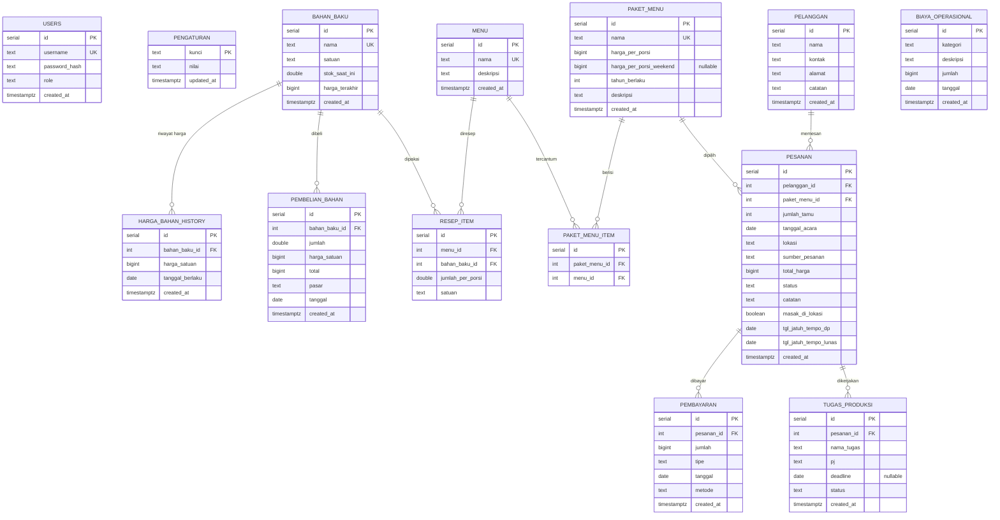
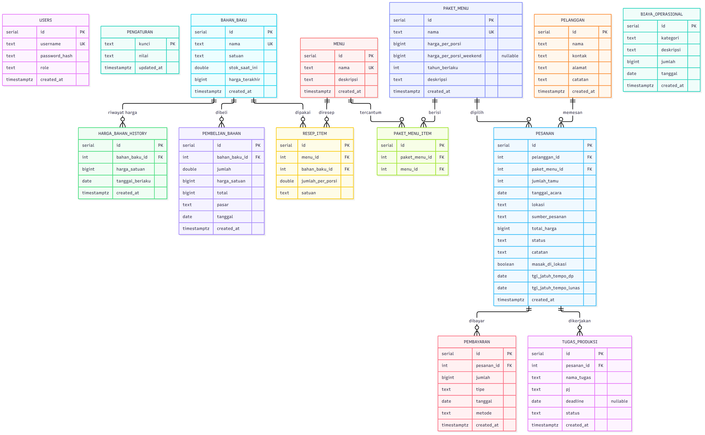

# Entity Relationship Diagram (ERD)

Dokumen ini memuat ERD lengkap beserta tabel desain basis data untuk Sistem Informasi
Manajemen (SIM) Dina Catering.

Basis data: **PostgreSQL 16**. Akses data memakai **sqlc (pgx/v5)** tanpa ORM.
Uang disimpan sebagai `BIGINT` (Rupiah bulat, tanpa pecahan), kuantitas sebagai
`DOUBLE PRECISION`.

---

## 1. ERD

### 1.1 Catatan penting

1. **`users` dan `pengaturan` berdiri sendiri.** Keduanya tidak memiliki foreign key ke tabel
 lain. Kolom `users.role` sudah tersedia untuk pembatasan hak akses di masa depan, tetapi
 belum ada kolom penforeign key dari `pesanan` ke `users`, sehingga **tidak ada relasi
 `users` — `pesanan`** dalam ERD ini. (Diagram ERD lama di `README.md` masih menuliskan
 relasi tersebut; yang digambar di sini mengikuti DDL sebenarnya pada `db/schema.sql`.)
2. **`pengaturan` adalah tabel key-value.** Barisnya dibuat dari kode, bukan dari form CRUD
 umum. Kunci yang dipakai saat ini: `biaya_operasional_persen` dengan nilai bawaan `10`.
3. **`harga_per_porsi_weekend` boleh NULL.** NULL berarti harga akhir pekan sama dengan harga
 biasa, sehingga tidak perlu baris tambahan.
4. **`pesanan.paket_menu_id` menunjuk baris harga yang spesifik per tahun.** Satu nama paket
 dapat memiliki banyak baris (satu untuk tiap tahun berlaku). Saat membuat pesanan, form
 memilih *nama paket* dan tanggal acara, lalu service mencari baris dengan
 `tahun_berlaku <= tahun(tanggal_acara)` yang paling dekat. Satu pesanan terkunci ke satu
 baris harga, sehingga harga paket yang kemudian berubah tidak mengubah total pesanan lama.
5. **`harga_bahan_history` menyimpan harga bertanggal berlaku.** Inilah yang membuat HPP
 historis bisa dihitung ulang: untuk tanggal acuan `t`, harga efektif bahan adalah baris
 terbaru dengan `tanggal_berlaku <= t`.

---

## 2. Tabel Relasi

| Relasi | Kardinalitas | Aturan Referential Integrity |
|---|---|---|
| `pelanggan` → `pesanan` | 1: N | `pesanan.pelanggan_id` → `pelanggan.id`. Tidak ada `ON DELETE`, sehingga pelanggan tidak bisa dihapus selama masih ada pesanan. |
| `paket_menu` → `pesanan` | 1: N | `pesanan.paket_menu_id` → `paket_menu.id`. |
| `menu` → `resep_item` | 1: N | `resep_item.menu_id` → `menu.id`, `ON DELETE CASCADE`. Menghapus menu ikut menghapus resepnya. |
| `bahan_baku` → `resep_item` | 1: N | `resep_item.bahan_baku_id` → `bahan_baku.id`. |
| `paket_menu` → `paket_menu_item` | 1: N | `paket_menu_item.paket_menu_id` → `paket_menu.id`, `ON DELETE CASCADE`. |
| `menu` → `paket_menu_item` | 1: N | `paket_menu_item.menu_id` → `menu.id`, `ON DELETE CASCADE`. |
| `bahan_baku` → `harga_bahan_history` | 1: N | `harga_bahan_history.bahan_baku_id` → `bahan_baku.id`, `ON DELETE CASCADE`. |
| `bahan_baku` → `pembelian_bahan` | 1: N | `pembelian_bahan.bahan_baku_id` → `bahan_baku.id`. |
| `pesanan` → `pembayaran` | 1: N | `pembayaran.pesanan_id` → `pesanan.id`, `ON DELETE CASCADE`. |
| `pesanan` → `tugas_produksi` | 1: N | `tugas_produksi.pesanan_id` → `pesanan.id`, `ON DELETE CASCADE`. |

---

## 3. Database Design

### 3.1 `users`

| Kolom | Tipe | Constraint | Keterangan |
|---|---|---|---|
| `id` | `SERIAL` | PK | Penomoran otomatis. |
| `username` | `TEXT` | NOT NULL, UNIQUE | Nama pengguna untuk login. |
| `password_hash` | `TEXT` | NOT NULL | Hash bcrypt. Diisi saat proses seed, bukan ditulis di dalam kode. |
| `role` | `TEXT` | NOT NULL, DEFAULT `'admin'` | Peran pengguna. Saat ini hanya ada nilai `admin`. |
| `created_at` | `TIMESTAMPTZ` | NOT NULL, DEFAULT `now()` | Waktu pembuatan akun. |

### 3.2 `pengaturan`

| Kolom | Tipe | Constraint | Keterangan |
|---|---|---|---|
| `kunci` | `TEXT` | PK | Kunci konfigurasi, mis. `biaya_operasional_persen`. |
| `nilai` | `TEXT` | NOT NULL | Nilai konfigurasi dalam bentuk teks. |
| `updated_at` | `TIMESTAMPTZ` | NOT NULL, DEFAULT `now()` | Waktu perubahan terakhir. |

### 3.3 `pelanggan`

| Kolom | Tipe | Constraint | Keterangan |
|---|---|---|---|
| `id` | `SERIAL` | PK | Penomoran otomatis. |
| `nama` | `TEXT` | NOT NULL | Nama lengkap pelanggan. |
| `kontak` | `TEXT` | NOT NULL, DEFAULT `''` | Nomor WhatsApp atau telepon. |
| `alamat` | `TEXT` | NOT NULL, DEFAULT `''` | Alamat pelanggan atau lokasi acara. |
| `catatan` | `TEXT` | NOT NULL, DEFAULT `''` | Catatan bebas, mis. preferensi paket. |
| `created_at` | `TIMESTAMPTZ` | NOT NULL, DEFAULT `now()` | Waktu pencatatan. |

### 3.4 `bahan_baku`

| Kolom | Tipe | Constraint | Keterangan |
|---|---|---|---|
| `id` | `SERIAL` | PK | Penomoran otomatis. |
| `nama` | `TEXT` | NOT NULL, UNIQUE | Nama bahan, mis. `Beras Premium`. |
| `satuan` | `TEXT` | NOT NULL, DEFAULT `'kg'` | Satuan takaran, mis. `kg`, `liter`. |
| `stok_saat_ini` | `DOUBLE PRECISION` | NOT NULL, DEFAULT `0` | Stok terkini. Bertambah saat pembelian, berkurang saat pesanan masuk produksi. |
| `harga_terakhir` | `BIGINT` | NOT NULL, DEFAULT `0` | Harga satuan terakhir dalam Rupiah. Diperbarui dari riwayat harga terbaru. |
| `created_at` | `TIMESTAMPTZ` | NOT NULL, DEFAULT `now()` | Waktu pencatatan bahan. |

### 3.5 `harga_bahan_history`

| Kolom | Tipe | Constraint | Keterangan |
|---|---|---|---|
| `id` | `SERIAL` | PK | Penomoran otomatis. |
| `bahan_baku_id` | `INTEGER` | NOT NULL, FK → `bahan_baku.id`, ON DELETE CASCADE | Bahan yang harga pada baris ini berlaku. |
| `harga_satuan` | `BIGINT` | NOT NULL | Harga satuan dalam Rupiah pada tanggal berlaku. |
| `tanggal_berlaku` | `DATE` | NOT NULL | Tanggal mulai harga ini berlaku. |
| `created_at` | `TIMESTAMPTZ` | NOT NULL, DEFAULT `now()` | Waktu pencatatan riwayat harga. |

### 3.6 `pembelian_bahan`

| Kolom | Tipe | Constraint | Keterangan |
|---|---|---|---|
| `id` | `SERIAL` | PK | Penomoran otomatis. |
| `bahan_baku_id` | `INTEGER` | NOT NULL, FK → `bahan_baku.id` | Bahan yang dibeli. |
| `jumlah` | `DOUBLE PRECISION` | NOT NULL | Jumlah yang dibeli. |
| `harga_satuan` | `BIGINT` | NOT NULL | Harga satuan saat pembelian. |
| `total` | `BIGINT` | NOT NULL | `jumlah x harga_satuan`, dibulatkan ke Rupiah penuh. |
| `pasar` | `TEXT` | NOT NULL, DEFAULT `''` | Nama pasar tempat pembelian, mis. `Pasar Ungaran`. |
| `tanggal` | `DATE` | NOT NULL | Tanggal pembelian. |
| `created_at` | `TIMESTAMPTZ` | NOT NULL, DEFAULT `now()` | Waktu pencatatan. |

### 3.7 `menu`

| Kolom | Tipe | Constraint | Keterangan |
|---|---|---|---|
| `id` | `SERIAL` | PK | Penomoran otomatis. |
| `nama` | `TEXT` | NOT NULL, UNIQUE | Nama menu, mis. `Ayam Bakar`. |
| `deskripsi` | `TEXT` | NOT NULL, DEFAULT `''` | Keterangan isi menu. |
| `created_at` | `TIMESTAMPTZ` | NOT NULL, DEFAULT `now()` | Waktu pencatatan menu. |

### 3.8 `resep_item`

| Kolom | Tipe | Constraint | Keterangan |
|---|---|---|---|
| `id` | `SERIAL` | PK | Penomoran otomatis. |
| `menu_id` | `INTEGER` | NOT NULL, FK → `menu.id`, ON DELETE CASCADE | Menu yang memakai bahan ini. |
| `bahan_baku_id` | `INTEGER` | NOT NULL, FK → `bahan_baku.id` | Bahan yang dipakai. |
| `jumlah_per_porsi` | `DOUBLE PRECISION` | NOT NULL | Takaran bahan per satu porsi. |
| `satuan` | `TEXT` | NOT NULL, DEFAULT `''` | Satuan takaran, mis. `kg`, `liter`. |

### 3.9 `paket_menu`

| Kolom | Tipe | Constraint | Keterangan |
|---|---|---|---|
| `id` | `SERIAL` | PK | Penomoran otomatis. |
| `nama` | `TEXT` | NOT NULL, UNIQUE bersama `tahun_berlaku` | Nama paket, mis. `Premium`. |
| `harga_per_porsi` | `BIGINT` | NOT NULL | Harga jual per porsi hari biasa. |
| `harga_per_porsi_weekend` | `BIGINT` | NULL | Harga jual per porsi Sabtu/Minggu. NULL berarti sama dengan harga biasa. |
| `tahun_berlaku` | `INTEGER` | NOT NULL | Tahun harga ini berlaku. |
| `deskripsi` | `TEXT` | NOT NULL, DEFAULT `''` | Keterangan isi paket. |
| `created_at` | `TIMESTAMPTZ` | NOT NULL, DEFAULT `now()` | Waktu pencatatan. |

### 3.10 `paket_menu_item`

| Kolom | Tipe | Constraint | Keterangan |
|---|---|---|---|
| `id` | `SERIAL` | PK | Penomoran otomatis. |
| `paket_menu_id` | `INTEGER` | NOT NULL, FK → `paket_menu.id`, ON DELETE CASCADE | Paket pemilik. |
| `menu_id` | `INTEGER` | NOT NULL, FK → `menu.id`, ON DELETE CASCADE | Menu yang tercantum dalam paket. |

### 3.11 `pesanan`

| Kolom | Tipe | Constraint | Keterangan |
|---|---|---|---|
| `id` | `SERIAL` | PK | Penomoran otomatis. UI menampilkan nomor sebagai `#<id>`. |
| `pelanggan_id` | `INTEGER` | NOT NULL, FK → `pelanggan.id` | Pelanggan pemesan. |
| `paket_menu_id` | `INTEGER` | NOT NULL, FK → `paket_menu.id` | Baris harga paket yang dipakai, terkunci per tahun berlaku. |
| `jumlah_tamu` | `INTEGER` | NOT NULL | Perkiraan jumlah tamu. |
| `tanggal_acara` | `DATE` | NOT NULL | Tanggal acara. Menentukan harga akhir pekan dan jadwal pembayaran. |
| `lokasi` | `TEXT` | NOT NULL, DEFAULT `''` | Lokasi acara. |
| `sumber_pesanan` | `TEXT` | NOT NULL, CHECK | Satu dari `instagram`, `mulut_ke_mulut`, `hotel`, `lainnya`. |
| `total_harga` | `BIGINT` | NOT NULL, DEFAULT `0` | `jumlah_tamu x harga_jual_efektif`. |
| `status` | `TEXT` | NOT NULL, DEFAULT `'baru'`, CHECK | Satu dari `baru`, `final_meeting`, `survei_lokasi`, `produksi`, `pengiriman`, `selesai`, `batal`. |
| `catatan` | `TEXT` | NOT NULL, DEFAULT `''` | Catatan bebas, mis. permintaan sambal terpisah. |
| `masak_di_lokasi` | `BOOLEAN` | NOT NULL, DEFAULT `false` | True bila makanan dimasak di lokasi acara. |
| `tgl_jatuh_tempo_dp` | `DATE` | NOT NULL | `tanggal_acara - 30 hari`. |
| `tgl_jatuh_tempo_lunas` | `DATE` | NOT NULL | `tanggal_acara - 7 hari`. |
| `created_at` | `TIMESTAMPTZ` | NOT NULL, DEFAULT `now()` | Waktu pencatatan pesanan. |

### 3.12 `pembayaran`

| Kolom | Tipe | Constraint | Keterangan |
|---|---|---|---|
| `id` | `SERIAL` | PK | Penomoran otomatis. |
| `pesanan_id` | `INTEGER` | NOT NULL, FK → `pesanan.id`, ON DELETE CASCADE | Pesanan yang dibayar. |
| `jumlah` | `BIGINT` | NOT NULL | Nominal pembayaran dalam Rupiah. |
| `tipe` | `TEXT` | NOT NULL, CHECK | `dp` atau `pelunasan`. |
| `tanggal` | `DATE` | NOT NULL | Tanggal pembayaran diterima. |
| `metode` | `TEXT` | NOT NULL, DEFAULT `'transfer'` | `transfer`, `tunai`, atau `kas`. |
| `created_at` | `TIMESTAMPTZ` | NOT NULL, DEFAULT `now()` | Waktu pencatatan pembayaran. |

### 3.13 `tugas_produksi`

| Kolom | Tipe | Constraint | Keterangan |
|---|---|---|---|
| `id` | `SERIAL` | PK | Penomoran otomatis. |
| `pesanan_id` | `INTEGER` | NOT NULL, FK → `pesanan.id`, ON DELETE CASCADE | Pesanan pemilik tugas. |
| `nama_tugas` | `TEXT` | NOT NULL | Nama tugas, mis. `Masak seluruh menu`. |
| `pj` | `TEXT` | NOT NULL, DEFAULT `''` | Penanggung jawab tugas. Diisi bebas, bukan referensi ke tabel pengguna. |
| `deadline` | `DATE` | NULL | Batas akhir pengerjaan tugas. |
| `status` | `TEXT` | NOT NULL, DEFAULT `'belum'`, CHECK | `belum`, `jalan`, atau `selesai`. |
| `created_at` | `TIMESTAMPTZ` | NOT NULL, DEFAULT `now()` | Waktu pembuatan tugas. |

### 3.14 `biaya_operasional`

| Kolom | Tipe | Constraint | Keterangan |
|---|---|---|---|
| `id` | `SERIAL` | PK | Penomoran otomatis. |
| `kategori` | `TEXT` | NOT NULL | Kategori biaya, mis. `Mobilitas`, `Gas`, `Listrik`, `Perlengkapan`. |
| `deskripsi` | `TEXT` | NOT NULL, DEFAULT `''` | Rincian biaya. |
| `jumlah` | `BIGINT` | NOT NULL | Nominal biaya dalam Rupiah. |
| `tanggal` | `DATE` | NOT NULL | Tanggal biaya terjadi. |
| `created_at` | `TIMESTAMPTZ` | NOT NULL, DEFAULT `now()` | Waktu pencatatan. |

---

## 4. Daftar Index

### 4.1 Index eksplisit

| Nama Index | Tabel | Kolom | Alasan |
|---|---|---|---|
| `idx_harga_bahan_riwayat` | `harga_bahan_history` | `bahan_baku_id`, `tanggal_berlaku DESC` | Mencari harga efektif terbaru pada tanggal tertentu. |
| `idx_pembelian_tanggal` | `pembelian_bahan` | `tanggal` | Filter pembelian per periode laporan. |
| `idx_resep_menu` | `resep_item` | `menu_id` | Mengambil resep satu menu. |
| `idx_paket_item_paket` | `paket_menu_item` | `paket_menu_id` | Mengambil isi satu paket. |
| `idx_pesanan_tanggal` | `pesanan` | `tanggal_acara` | Agenda acara dan rentang tanggal. |
| `idx_pesanan_status` | `pesanan` | `status` | Rekap pesanan per status. |
| `idx_pembayaran_pesanan` | `pembayaran` | `pesanan_id` | Total pembayaran per pesanan. |
| `idx_tugas_pesanan` | `tugas_produksi` | `pesanan_id` | Tugas milik satu pesanan. |
| `idx_tugas_deadline` | `tugas_produksi` | `deadline` | Papan produksi berdasarkan tenggat. |
| `idx_biaya_tanggal` | `biaya_operasional` | `tanggal` | Rekap biaya operasional per periode laporan. |

### 4.2 Index unik implisit

| Tabel | Kolom | Diterbitkan oleh |
|---|---|---|
| `users` | `username` | `UNIQUE` |
| `bahan_baku` | `nama` | `UNIQUE` |
| `menu` | `nama` | `UNIQUE` |
| `paket_menu` | `nama`, `tahun_berlaku` | `UNIQUE` |
| `pengaturan` | `kunci` | Primary key |

---

## 5. Relasi Turunan (tidak disimpan di basis data)

Beberapa nilai yang dipakai pada laporan dihitung dari data yang sudah ada, bukan disimpan
sebagai kolom tersendiri.

| Nilai Turunan | Cara Perhitungan |
|---|---|
| Status pembayaran pesanan | `SUM(pembayaran.jumlah)` dibandingkan `pesanan.total_harga`: belum DP, DP terbayar, atau lunas. |
| Sisa tagihan | `pesanan.total_harga - SUM(pembayaran.jumlah)`. |
| Label jatuh tempo | Perbandingan `tanggal_acara - 30` atau `- 7` terhadap tanggal hari ini. |
| HPP per porsi | `SUM(resep_item.jumlah_per_porsi x harga_efektif) x (1 + persen_operasional / 100)`. |
| HPP paket | Penjumlahan HPP per porsi seluruh menu dalam paket. |
| Margin paket | `(harga_jual_efektif - HPP_paket) / harga_jual_efektif x 100`. |
| Harga jual minimum | `HPP / 0,7` (margin 30%). |
| Keuntungan periode | `SUM(pembayaran) - SUM(pembelian_bahan) - SUM(biaya_operasional)`. |
| Jumlah pesanan per pelanggan | `COUNT(pesanan)` dikelompokkan `pelanggan_id`. |
